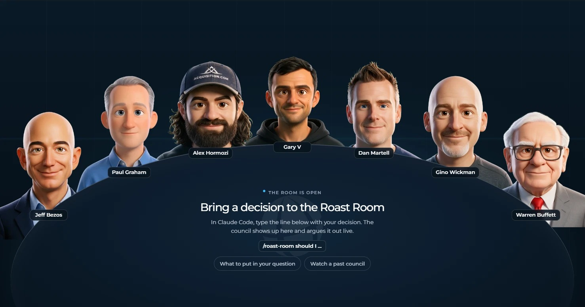

# Roast Room (OpenCode edition)



Bring a hard business decision and a council of AI advisors argues it out, then hands you a scored verdict and a one-click PDF. Twelve advisors ship with it, each built from that person's public work: their letters, essays, talks, and videos. For each question, the Chair recommends who should sit on the council and you confirm. The council runs in **OpenCode**, and a small local web app shows them around a table talking it through. Want someone else at the table? Type `/newroaster` and a name, and the agent builds that advisor the same way.

This repository is the original Roast Room, rewired to run on OpenCode. Agents, skills, and project instructions are OpenCode-first. See [AGENTS.md](AGENTS.md) for the agent-facing instructions.

| Seat | Pillar | The question they own |
|---|---|---|
| Jeff Bezos | Strategy and decisions | Is this the right bet, and how reversible is it? |
| Paul Graham | Product and startups | Do people actually want this, and is it growing? |
| Alex Hormozi | Offers, pricing, and sales | Will people pay, how much, and how do we close? |
| Gary Vaynerchuk | Marketing and attention | Where does the attention come from? |
| Dan Martell | People, hiring, and founder time | Who does this, and what does it cost your calendar? |
| Gino Wickman | Operations and scaling | Can the business run this without you holding it together? |
| Warren Buffett | Money and capital | What does it do to cash, risk, and long-term value? |

Those seven are the **default board**. Five more advisors are on call, and the Chair brings them in when your question is in their lane:

| Seat | Pillar | The question they own |
|---|---|---|
| Naval Ravikant | Leverage and wealth | Does this build leverage and equity you own, or does it just rent out your time? |
| Codie Sanchez | Buying and owning small businesses | Should you build this, or buy something that already works? |
| Leila Hormozi | Leadership and scaling teams | Can your team and your leadership carry this, and who has to change? |
| Sara Blakely | Consumer product and brand from zero | Will customers love it enough to sell it for you, without outside money? |
| Elon Musk | First principles and execution speed | What is the real constraint here, and can we cut steps and build it faster? |

## What you need

- [OpenCode](https://opencode.ai), with a model you can run subagents on.
- [Node.js](https://nodejs.org) 20 or newer, for the room. There is nothing else to install. The app uses Node built-ins only.

## Setup

```bash
git clone https://github.com/KarthikeyaPodicheti/roastroom-opencode.git
cd roastroom-opencode
npm start
```

`npm start` serves the room at http://localhost:4730. Leave it running.

In a second terminal, in the same folder:

```bash
opencode
```

OpenCode reads `AGENTS.md` automatically and discovers the council and newroaster skills from `.claude/skills`. The seat subagents are in `.opencode/agents`.

## Run a roast

1. Start the room: `npm start`, then open http://localhost:4730. Leave it open.
2. Open OpenCode in the same folder: `opencode`
3. Type `/roast-room` and your decision. If the slash command does not appear, just describe the decision and ask for the Roast Room.
4. Answer the Chair's questions, then watch the council argue it out in the room.
5. When the verdict lands, click **Download PDF**.

You also get a short verdict in chat, and the full report lands in `sessions/<date>-<decision>/verdict.md`.

## What to put in your question

The council is only as good as what you give it. Include:

- **The decision** in one line.
- **Your options.** Two or three. "Keep doing what I do now" counts.
- **Your numbers.** Revenue, cash, and team size.
- **Your limits.** Deadline, hours, and budget.
- **What success looks like**, and by when.
- **Which way you are leaning**, and why. The council tests your lean instead of agreeing with it.

Left something out? The Chair asks before the council starts. Example:

```
/roast-room I run a coaching business at $30k a month with 15 clients at $2,000 each.
Should I raise to $3,500 for everyone, raise for new clients only, or keep $2,000?
Close rate is about 50% and I have $40k in the bank. Success is $45k a month by March.
I'm leaning toward raising for everyone because I'm underpaid.
```

More ways to run it:

- `/roast-room --quick ...` seats four advisors for two rounds. Use it for smaller, reversible calls. It uses far less of your model budget.
- `/roast-room --seats hormozi,buffett ...` seats only the advisors you name.
- `/roast-room ask hormozi ...` gets one answer from one seat.
- `/roast-room --all ...` seats every advisor you have (up to nine).
- `/roast-room board` shows who sits at the table by default and lets you change it.

The room is optional. The council runs the same in OpenCode without it. If you want the room to run councils without OpenCode at all, copy `.env.example` to `.env`, add an `ANTHROPIC_API_KEY`, and set `COUNCIL_RUNNER=api`.

## Choose who sits at the table

When you run `/roast-room`, the Chair reads your question and recommends a council from every advisor you have, with one line on why each one fits. You pick:

- **Recommended board**: the five to seven advisors the Chair picked for this question.
- **Default board**: your usual seven.
- **Everyone**: all of them, when you have nine or fewer.
- **Other**: type changes, like "recommended, but add Naval and drop Wickman".

A pricing question might get Hormozi, Buffett, Codie Sanchez, Sara Blakely, and Graham. A hiring question might get Leila Hormozi, Martell, Wickman, Naval, and Buffett. Every council keeps a seat that guards your downside and one that is likely to disagree, so the room argues instead of nodding.

How the board gets picked is a setting in `.claude/skills/roast-room/roster.json`:

```json
{
  "board": "ask",
  "default": ["bezos", "graham", "hormozi", "garyvee", "martell", "wickman", "buffett"],
  "seats": [ ...every advisor you have... ]
}
```

| Setting | What happens on every `/roast-room` |
|---|---|
| `"ask"` (out of the box) | The Chair recommends a council and asks you to confirm it. |
| `"auto"` | The Chair picks the council and tells you who and why, without asking. |
| `"default"` | Your default board sits every time. No question. |

You do not need to edit the file by hand. Type `/roast-room board` and say what you want: "put Naval on my default board", "take Gary V off", or "stop asking me, just use my default board".

## Add your own advisor

```
/newroaster Morgan Housel
```

The agent builds a new seat the way the original seven were built:

1. **Asks two or three questions**: the business pillar and question the advisor owns, whether they join your default board, and how deep to go.
2. **Finds their public work**: essays, letters, talks, long interviews, and podcasts where they are the main speaker.
3. **Fetches it** into `build/<name>/`, a local folder git ignores. Web pages become text and YouTube videos become transcripts.
4. **Extracts how they think**: parallel subagents read every source and pull out their frameworks, rules, positions, stories, and voice, with verbatim quotes.
5. **Writes the brain** (`.claude/skills/roast-room/brains/<name>/`) and checks that every quote is word for word in the source it cites.
6. **Writes the advisor's agent** (`.claude/agents/council-<name>.md` and `.opencode/agents/council-<name>.md`) and adds them to `roster.json`.
7. **Makes their portrait** for the room from a real photo, in the same cartoon style as the other advisors.
8. **Tests the new seat** on a sample question, then tells you how to use it.

| Depth | Sources | Good for |
|---|---|---|
| `--quick` | 12 to 20 | Trying someone out |
| default | 30 to 50 | An advisor you'll use |
| `--deep` | 80+ | Matching the original seven |

A standard build is about 8 to 10 subagent runs. When it finishes, open a new OpenCode session so the advisor loads as its own agent. Until then the council falls back to a general subagent and the skill still works.

You can build an advisor from public figures, living or historical, with a real body of public work, or from your own material if you want yourself or a consenting mentor on the board. The raw sources stay on your machine; only the brain, which holds short quotes and paraphrase, is meant to be committed.

If an advisor was added without a portrait, the room shows a placeholder. A portrait needs a [kie.ai](https://kie.ai/api-key) key in `.env` (`KIE_AI_API_KEY=`) and Python with `opencv-python`. Run `/newroaster portrait <name>` later to fill it in.

## Watch an example first

Run `npm start`, open http://localhost:4730, and click **Past sessions**. Three finished councils ship with the repo, so you can see how it works and download their PDFs before you run your own.

## How it works

- **The council runs in OpenCode.** Each seat is a subagent (`.opencode/agents/council-*.md`, listed in `roster.json`) that reads its own brain (`.claude/skills/roast-room/brains/<name>/`): frameworks, principles, positions, stories, and voice notes compiled from public sources, with every quote tied to a source. OpenCode acts as the Chair. It runs the rounds, keeps score, and writes the verdict (`.claude/skills/roast-room/SKILL.md`).
- **Each seat scores every option**, weighted by how much that seat's pillar matters to your decision. The Chair caps the verdict when a seat flags ruin risk, and it forces a real argument when everyone agrees too fast.
- **The room only watches.** As the Chair works, it writes each step to `sessions/`, and the app plays those files back. The room makes no AI calls of its own.
- **Every council is saved** in `sessions/`. Past sessions replays any of them and downloads its PDF.
- **Usage:** a full council is three subagent runs per seat (21 for seven). Use `--quick` for small calls.

## AGENTS.md

`AGENTS.md` at the repo root is the project instruction file for OpenCode. It tells the agent where the council skill, the seats, the roster, and the room live, and which rules to follow. If you fork this project or change the layout, update `AGENTS.md` first: OpenCode reads it at the start of every session.

## What's inside

| Path | What |
|---|---|
| `AGENTS.md` | OpenCode project instructions |
| `.claude/skills/roast-room/` | The council skill: protocol, prompts, scoring, report template, and one brain per advisor |
| `.claude/skills/roast-room/roster.json` | Every advisor, your default board, and how the board is picked |
| `.claude/skills/newroaster/` | The `/newroaster` skill and its scripts: fetch sources, check quotes, register a seat |
| `.opencode/agents/` | One OpenCode subagent per advisor (`council-<name>.md`) |
| `.opencode/convert-agents.mjs` | Regenerates the OpenCode agents from the `.claude/agents` originals |
| `app/` | The room: a zero-dependency Node server, the web page, and the PDF builder |
| `sessions/` | Your councils (kept out of git) and the three examples |
| `build/` | Raw sources `/newroaster` fetched (kept out of git) |

## Privacy

Your councils are yours. `sessions/*` is gitignored, so a session only lands in git if you force-add it. `.env`, `build/`, and local logs are gitignored too. Nothing from your business is sent anywhere by the room; the app binds to `127.0.0.1`.

## About the advisors

These are simulations built from each person's public work, and so is any advisor you add. They are not the people, they do not speak for them, and none of them is affiliated with or endorses this project. A seat only quotes a person verbatim when the line is in its brain with a source, and `python3 .claude/skills/roast-room/scripts/check_quotes.py sessions/<session>` checks every quote in a council against the brains. Each brain's `sources.md` lists what it was built from.

Originally built by AI Automation Society. The code is MIT licensed; see `LICENSE`. The PDF builder bundles [jsPDF](https://github.com/parallax/jsPDF) (MIT) and [Montserrat](https://github.com/JulietaUla/Montserrat) (SIL Open Font License); their licenses sit next to them in `app/public/`.
